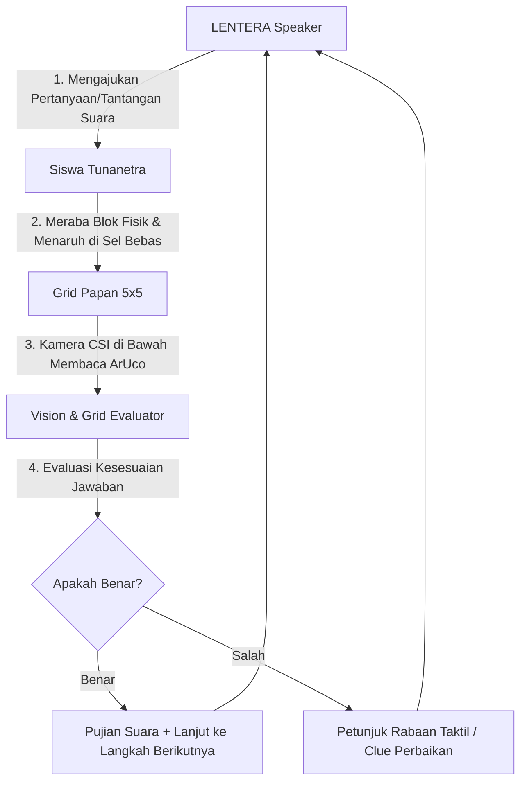

# KONSEP & PANDUAN: INTERACTIVE TACTILE AI TUTOR (LENTERA)
### Solusi Kemandirian 100% Siswa Tunanetra Melalui Tangible Socratic Dialogue

---

## 1. Latar Belakang & Analisis Masalah

### 1.1 Celah yang Sering Diuji Juri Kompetisi
Pada kompetisi inovasi teknologi asistif untuk penyandang disabilitas (khususnya tunanetra), juri hampir selalu mengajukan pertanyaan kritis:
> *"Apakah alat ini benar-benar bisa digunakan secara mandiri oleh siswa tunanetra, atau masih harus didampingi operator/guru yang mengklik menu di laptop?"*

Saat ini, pemilihan modul/target pembelajaran (seperti seri vs paralel) berada di antarmuka web, sementara siswa tunanetra berhadapan dengan papan fisik. Hal ini menimbulkan persepsi bahwa siswa masih bergantung pada orang berpenglihatan untuk mengoperasikan sistem.

### 1.2 Mengapa Bukan Voice Command (Mikrofon)?
Gagasan menambahkan perintah suara (*Voice Command / Speech-to-Text*) sering muncul, namun memiliki kelemahan teknis fatal pada perangkat nyata:
1. **Keterbatasan Hardware:** Raspberry Pi 4B **tidak memiliki mikrofon bawaan** (hanya output audio 3.5mm/HDMI), sehingga memerlukan tambahan USB mic eksternal.
2. **Kondisi Lapangan Lomba:** Ruang pameran dan penjurian selalu bising. Mikrofon rentan menangkap suara orang lain atau mengalami *acoustic feedback* (gema dari speaker LENTERA sendiri).
3. **Ketergantungan Internet vs Latensi:** Speech-to-Text bahasa Indonesia yang akurat umumnya berbasis Cloud API (butuh internet stabil). Jika dipaksa berjalan offline di CPU Pi 4 (misal: PocketSphinx/Vosk), akurasi dialek/noise rendah dan menimbulkan latensi 2–4 detik.

---

## 2. Solusi: *Tangible Interaction as Answer* (Aksi Taktil sebagai Jawaban)

### 2.1 Paradigma Utama
> **"Papan adalah Layar, dan Blok Fisik adalah Tombol Jawabannya."**

Alih-alih siswa berbicara ke mikrofon atau menyentuh layar sentuh, **sistem LENTERA mengambil inisiatif bertanya melalui audio (speaker board)**, dan **siswa menjawab dengan cara meletakkan blok fisik ke grid**.

Kamera ArUco di bawah papan yang sudah terpasang bertindak sebagai "mata" yang membaca jawaban siswa secara instan, akurat, dan bebas gangguan kebisingan ruangan.

### 2.2 Alur Interaksi (Socratic Feedback Loop)



---

## 3. Contoh Penerapan Nyata & Naskah Dialog Interaktif

### Modul A: Kuis Diagnostik & Pengenalan Komponen (Interactive Quiz)
*Tujuan: Menguji pemahaman siswa tentang fungsi dan karakteristik taktil tiap komponen.*

1. **Pertanyaan 1 (Sumber Listrik):**
   - **Speaker LENTERA:**  
     *"Halo! Mari belajar bersama LENTERA. Di depanmu ada beberapa komponen fisik. Komponen manakah yang berfungsi sebagai penyimpan energi dan sumber tegangan listrik? Raba dan letakkan komponen tersebut di papan untuk menjawab."*
   - **Skenario A (Jawaban Benar):**  
     Siswa meraba blok baterai (ada tonjolan kutub + dan -), lalu meletakkannya di koordinat **C3**.  
     - **Speaker:** *"Hebat sekali! Jawabanmu benar. Baterai adalah sumber tegangan DC. Sekarang, komponen manakah yang dapat mengubah energi listrik menjadi cahaya?"*
   - **Skenario B (Jawaban Salah - Siswa meletakkan Kabel Lurus):**  
     Siswa meletakkan Kabel Lurus di papan.  
     - **Speaker:** *"Itu adalah kabel lurus, fungsinya menghantarkan arus listrik dari satu titik ke titik lain. Coba raba blok lain yang memiliki penutup kubah bulat dan terminal kutub (baterai)."*

2. **Pertanyaan 2 (Pengendali Aliran):**
   - **Speaker LENTERA:**  
     *"Komponen mana yang memiliki tuas putar dan berfungsi memutus atau menyambungkan aliran listrik?"*
   - Siswa meletakkan Saklar (ID 7).
   - **Speaker:** *"Tepat! Itu adalah saklar. Jika diputar sejajar kawat listrik akan terbuka atau mati, dan jika diputar akan menyambungkan sirkuit."*

---

### Modul B: Panduan Merangkai Mandiri Tahap-demi-Tahap (Adaptive Scaffolding)
*Tujuan: Membimbing siswa membangun sirkuit seri lengkap tanpa panduan visual.*

1. **Langkah 1 (Penempatan Sumber Tegangan & Deteksi Arah Kutub):**
   - **Speaker LENTERA:**  
     *"Mari kita bangun rangkaian seri satu lampu. Pertama, letakkan baterai di posisi mana pun yang kamu inginkan di papan."*
   
   - **Jika Siswa Meletakkan Baterai VERTIKAL di C4 (Rotasi 0° / + di Atas, - di Bawah):**  
     Terminal baterai membuka ke atas (C5) dan ke bawah (C3). Sisi kiri dan kanan baterai tidak memiliki kontak.  
     - **Speaker:** *"Baterai terdeteksi vertikal di C4. Kutub positif menghadap ke atas menuju C5, dan kutub negatif ke arah C3. Letakkan kabel siku L di atas baterai (di C5) untuk membelokkan arus ke kolom samping."*

   - **Jika Siswa Meletakkan Baterai HORIZONTAL di C4 (Rotasi 270° / + di Kiri, - di Kanan):**  
     Terminal baterai langsung membuka ke B4 (kiri) dan D4 (kanan).  
     - **Speaker:** *"Baterai terdeteksi horizontal di C4. Kutub positif menghadap ke kiri (B4) dan negatif ke kanan (D4). Pasang kabel sudut L di B4 yang mengarah ke bawah untuk mulai membuat loop."*

2. **Langkah 2 (Menyusun Jalur Belokan Kabel L):**
   - Pada posisi baterai horizontal di C4:  
     Siswa menaruh kabel sudut L di **B4** (membelokkan arus dari C4 ke arah bawah menuju baris 2).  
     - **Speaker:** *"Bagus! Kabel L di B4 sudah terhubung ke kutub positif baterai dan mengarah ke bawah. Sekarang letakkan beban lampu di baris bawah (C2)."*

3. **Langkah 3 (Penempatan Beban Lampu):**
   - Siswa meletakkan lampu di **C2** (rotasi horizontal: + di kiri, - di kanan).  
   - **Speaker:** *"Lampu terpasang di C2. Sambungkan kabel sudut di B2 agar arus dari B4 dan B3 masuk ke kutub positif lampu."*

4. **Langkah 4 (Penyelesaian Loop Sirkuit di Sisi Kanan):**
   - Siswa menyambungkan kabel di **B2**, kabel lurus di **B3**, lalu menyusun jalur kembali di sisi kanan (**D2**, **D3/Saklar**, **D4**).  
   - Begitu loop tertutup sempurna dan polaritas sesuai:  
   - **Buzzer:** Berbunyi nada sukses (2x bip pendek).  
   - **Speaker:** *"Selamat! Rangkaian berhasil menyala sempurna. Kamu telah membuat rangkaian seri satu lampu secara mandiri."*

---

### Modul C: Diagnostik Kesalahan yang Mendidik (Socratic Error Handling)
Jika siswa melakukan kesalahan saat merangkai, sistem tidak hanya memberi tahu "salah", melainkan memberikan petunjuk fisik/logis:

| Kondisi Fisik di Papan | Audio LENTERA ke Siswa |
|---|---|
| **Korsleting (Short Circuit)** | *"Peringatan! Baterai terhubung langsung dari kutub positif ke negatif tanpa beban lampu. Segera angkat salah satu kabel atau pasang lampu agar baterai tidak panas."* |
| **Polaritas Terbalik** | *"Rangkaian sudah membentuk loop tertutup, namun lampu di C2 belum menyala karena kutub terbalik. Angkat lampu di C2 dan putar arahnya 180 derajat."* |
| **Saklar Terpasang tapi Mati (OFF)** | *"Rangkaian sudah terhubung dengan saklar di D3, namun saklar masih dalam posisi mati. Putar tuas saklar di D3 untuk menyalakan lampu."* |
| **Kabel Terputus (Open Circuit)** | *"Rangkaian belum tersambung utuh. Periksa sel di antara C4 dan D4, sepertinya jalur kawat masih terbuka."* |

---

## 4. Keuntungan Kompetitif di Hadapan Juri (Pitching Defense Points)

Jika juri bertanya:
> *"Kenapa tidak memakai Voice Command (mic) atau tombol layar sentuh seperti aplikasi edukasi biasa?"*

Anda dapat menjawab dengan 4 poin kuat berikut:
1. **Haptic Primacy (Tangan adalah Mata Bagi Tunanetra):**  
   Pendidikan anak tunanetra berfokus pada pengalaman taktil konkrit (*concrete tactile experience*). Membiarkan tangan anak terus berada di atas papan fisik dan berdialog dengan blok jauh lebih efektif dibanding membagi fokus antara papan dan mikrofon.
2. **Noise-Immune (Bebas Gangguan Bising):**  
   Pengenalan berbasis ArUco bawah akrilik memiliki akurasi 100% tanpa terpengaruh kebisingan suara penonton, gema ruangan, maupun variasi dialek bicara siswa.
3. **Socratic AI Tutoring (Bukan Sekadar Pendeteksi Pasif):**  
   LENTERA bertindak sebagai mitra belajar aktif yang mengamati gerak-gerik siswa secara real-time dan memberikan *guided inquiry* adaptif.
4. **Peran Web Dashboard yang Sebenarnya:**  
   Web portal bukan alat yang harus dioperasikan siswa, melainkan *Observer & Analytics Portal* untuk guru/orang tua guna memantau perkembangan kompetensi sains anak dari jarak jauh.

---

## 5. Rencana Arsitektur & Implementasi Teknis (Roadmap)

### Struktur Modul Skenario (`backend/logic/tutor.py` di masa depan)
```python
# Contoh struktur data skenario interaktif yang ringan dan modular
SCENARIOS = {
    "quiz_intro": [
        {
            "id": "q1_battery",
            "prompt": "Di antara komponen di depanmu, manakah yang merupakan sumber energi listrik? Letakkan di papan untuk menjawab.",
            "expected_component": "battery",
            "success_narration": "Tepat sekali! Baterai adalah sumber tegangan listrik.",
            "hint_narration": "Coba cari blok yang memiliki tanda positif dan negatif timbul."
        },
        {
            "id": "q2_switch",
            "prompt": "Komponen manakah yang berfungsi memutus dan menyambungkan arus listrik?",
            "expected_component": "switch",
            "success_narration": "Benar! Saklar memiliki tuas putar untuk mengontrol aliran arus.",
            "hint_narration": "Cari blok yang memiliki tuas timbul di permukaannya."
        }
    ]
}
```

### Integrasi Event:
- Modul tutor mendengarkan event `component_placed` dari [grid_state.py](file:///l:/LENTERA%20MALAYSIA/backend/logic/grid_state.py).
- Jika komponen yang diletakkan cocok dengan `expected_component`:
  - Enqueue audio pujian ke `audio.enqueue_narration()`.
  - Pindah ke indeks pertanyaan berikutnya.
  - Broadcast status step ke Web Portal via WebSocket (`type: "tutor_step"`).
- Jika salah:
  - Enqueue audio petunjuk (*hint*).

---

## 6. Kesimpulan

Dengan konsep **Interactive Tactile AI Tutor**, LENTERA naik kelas dari sekadar "papan sensor" menjadi **ekosistem pembelajaran adaptif yang utuh dan mandiri**. Siswa tunanetra belajar secara alami melalui dialog suara dan eksplorasi rabaan tanpa memerlukan ketergantungan operator visual.
