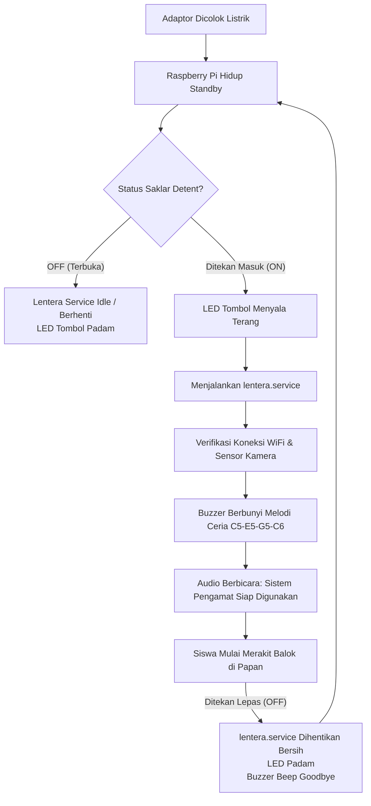

# Panduan Wiring & Integrasi Saklar Detent 4-Pin LENTERA

Panduan ini mengatur penggunaan **Push Button Stainless 4-Pin tipe Detent (Latching / Mengunci)** pada Raspberry Pi.

---

## 1. Karakteristik Tombol Detent 4-Pin

Di bagian belakang saklar terdapat 4 kaki terminal:
1. **`+` (LED Anoda)**: Kaki positif lampu cincin LED tombol.
2. **`-` (LED Katoda)**: Kaki negatif lampu cincin LED tombol.
3. **Kontak Saklar 1 (NO)**: Kaki kontak saklar (bebas bolak-balik).
4. **Kontak Saklar 2 (NO)**: Kaki kontak saklar (bebas bolak-balik).

> **Mekanisme Detent:**
> - **Ditekan 1x (Masuk/Mengunci = ON):** Kedua kaki NO terhubung.
> - **Ditekan 1x lagi (Lepas/Maju = OFF):** Kedua kaki NO terputus.

---

## 2. Skema Pengkabelan (Wiring ke Raspberry Pi)

Gunakan **GPIO 26 (Pin 37)** dan **GPIO 16 (Pin 36)** karena letaknya berdampingan dengan pin **GND (Pin 39 & 34)** di ujung bawah header Raspberry Pi.

| Kaki Tombol Fisik | Sambungkan ke Pin Raspberry Pi | Nomor Pin Fisik Header | Fungsi |
| :--- | :--- | :---: | :--- |
| **Kontak Saklar 1** | **GPIO 26** | **Pin 37** | Sinyal Deteksi ON / OFF (Internal Pull-Up) |
| **Kontak Saklar 2** | **GND** | **Pin 39** | Ground Kontak Saklar |
| **LED (+)** | **GPIO 16** | **Pin 36** | Output Kontrol Nyala LED Tombol |
| **LED (-)** | **GND** | **Pin 34** | Ground Lampu LED |

```
                ┌─────────────────────────────────┐
                │   TOMBOL DETENT 4-PIN LENTERA   │
                │                                 │
                │   [Kontak 1]       [Kontak 2]   │
                │       │                │        │
                │     [LED +]          [LED -]    │
                └───────┬────────────────┬────────┘
                        │                │
 ┌──────────────────────┼────────────────┼──────────────────────┐
 │                      │                │                      │
 ▼                      ▼                ▼                      ▼
Pin 37 (GPIO 26)     Pin 36 (GPIO 16)   Pin 39 (GND)          Pin 34 (GND)
(Deteksi Saklar)     (Lampu LED Saklar) (Ground Kontak)       (Ground LED)
```

---

## 3. Alur Kerja Sistem (Workflow)



---

## 4. Cara Instalasi Service di Raspberry Pi

Jalankan perintah berikut di terminal Raspberry Pi:

```bash
# 1. Masuk ke folder project
cd /home/pilentera/Lentera-Malaysia

# 2. Salin file service switch daemon
sudo cp lentera-switch.service /etc/systemd/system/

# 3. Nonaktifkan autostart langsung lentera.service (agar dikontrol oleh switch)
sudo systemctl disable lentera.service
sudo systemctl stop lentera.service

# 4. Aktifkan switch daemon service
sudo systemctl daemon-reload
sudo systemctl enable lentera-switch.service
sudo systemctl start lentera-switch.service
```

---

## 5. Keunggulan Desain Ini
1. **MicroSD 100% Aman**: Raspberry Pi tetap dialiri listrik stabil saat adaptor tertancap. Tidak ada pemutusan arus paksa (*hard-cut*).
2. **Hemat Daya & Dingin**: Saat tombol OFF, kamera dan proses AI Computer Vision mati total (beban CPU 0%).
3. **Instan**: Begitu tombol ditekan ON, sistem hanya butuh 2–3 detik untuk menyala (karena OS Linux sudah siap tanpa harus *cold boot* dari nol).
4. **Indikator Jelas**:
   - Lampu ring LED tombol menyala hanya saat sistem aktif.
   - Buzzer melodi 4 nada (*Do-Mi-Sol-Do*) hanya berbunyi saat WiFi sudah terhubung dan kamera sudah siap membaca balok.
